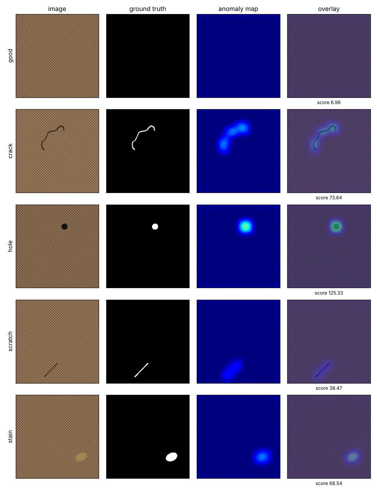

# Visual Anomaly Detection (PatchCore-style, no pretrained weights)

Unsupervised defect detection and localisation: the model is fitted on **normal images only**, then
scores every test image and produces a pixel-level anomaly heatmap.



## How it works

1. **Dense patch descriptors** (`anomaly/features.py`): per pixel, 8 Gabor magnitudes (4 orientations x 2 scales),
   3 Lab colour channels and a gradient magnitude. These are average-pooled to a 32x32 grid, and each cell is
   described together with its 3x3 neighbourhood (108 dims).
2. **Memory bank** (`anomaly/model.py`): descriptors from all normal training images are standardised and reduced
   with greedy k-center **coreset subsampling** to 10% of the patches.
3. **Scoring**: a test patch's anomaly score is its distance to the nearest memory-bank patch. The patch scores are
   upsampled and Gaussian-smoothed into a heatmap; the **image score is the heatmap maximum**.

This is the PatchCore recipe, with hand-crafted features instead of a pretrained CNN backbone so that it runs
anywhere with only `numpy`, `opencv` and `scikit-learn`.

## Results (synthetic textures)

Dataset: two procedurally generated textures (woven fabric, brushed metal), 40 normal training images each,
and 60 test images each (20 normal + 10 each of scratch, stain, crack, hole) with exact ground-truth masks.

| Category | Image AUROC | Pixel AUROC | Pixel AP | Latency (CPU) |
|----------|-------------|-------------|----------|---------------|
| fabric   | 1.000       | 0.995       | 0.498    | ~42 ms/img    |
| metal    | 0.987       | 0.988       | 0.351    | ~42 ms/img    |
| **mean** | **0.994**   | **0.992**   | **0.424**|               |

Measured on a 2-core CPU, 256x256 images, one run with seed 0 (`assets/results.json` has the details).

**Read these numbers with care.** The data is synthetic and the defects are fairly obvious, so the high AUROC
mostly shows that the pipeline is correct, not that it would match a deep model on real data. The low pixel AP
(0.35-0.50) is the more informative figure: heatmaps are blurry blobs around defects, so thin structures
such as scratches and cracks are localised coarsely. Brushed-metal scratches are the weakest case
(image AUROC 0.95), because they resemble the texture's own streaks.

## Quick start

```bash
pip install -r requirements.txt
python scripts/generate_synthetic.py --out data/synthetic
python scripts/run.py --data data/synthetic --out outputs
pytest
```

## Run on MVTec AD

The loader reads the standard MVTec AD folder layout, so real data works unchanged
(download from the [MVTec AD page](https://www.mvtec.com/company/research/datasets/mvtec-ad)):

```bash
python scripts/run.py --data /path/to/mvtec_ad --categories bottle tile --out outputs_mvtec
```

I have not run it on MVTec AD yet, so no real-benchmark numbers are claimed here. Expect hand-crafted
features to do clearly worse than a pretrained backbone on object categories.

## Project layout

```
anomaly/
  features.py   Gabor + colour + gradient patch descriptors
  model.py      coreset memory bank, kNN scoring, anomaly maps
  data.py       MVTec-layout loader
  synthetic.py  procedural textures + defects with masks
  metrics.py    image / pixel AUROC, pixel AP, per-defect AUROC
scripts/        generate_synthetic.py, run.py (metrics + heatmap figures)
tests/          end-to-end smoke test
```

## Next steps

- Swap the descriptors for pretrained ResNet / WideResNet layer-2+3 features (the real PatchCore backbone) and
  compare against the hand-crafted baseline on MVTec AD.
- Add the PRO (per-region overlap) metric and a threshold-selection step.
- Export to ONNX and benchmark edge latency.
